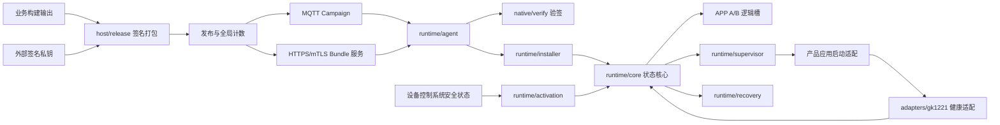
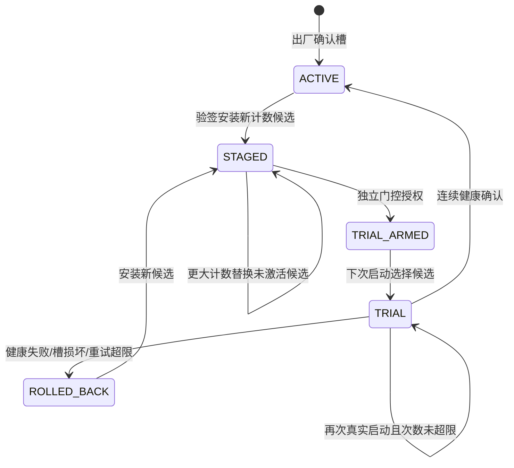

# APP-OTA 新架构

## 目标与边界

OTA 成为独立于 GK1221 SDK 和 ADAS/NPU 业务的项目：可离线构建原生工具，可单独打包与签名应用，可生成平台 rootfs 覆盖层。保留已存在的 Bundle v2、Campaign v1、State v1 协议。产品 profile 和健康适配器承载 GK1221 差异；核心状态与安装流程不导入任何 NPU/ISP SDK 库。

本轮实际拆分代码、构建与集成入口；没有更换语言重写已经存在的状态机。设备仍运行 POSIX shell 控制程序及 C 原生工具。已有硬件路径和业务健康语义明确归入 GK1221 适配层；新增产品需要实现自己的 profile、启动和健康适配，尚不能声称任意平台开箱即用。

## 模块关系



网络平面只处理通知和下载；设备授权来自独立控制系统。网络 Campaign 即使签名正确也不能直接切换正在工作的应用。`ota-agentd` 不写 safe_to_update、不调用 authorize，也不执行 reboot。

## 职责与代码落点

1. **发行平面 `host/release`**：从业务 APP 源目录取 profile 白名单文件，统一权限，生成内容清单和元数据，用外部私钥签名。发行计数跨版本递增；发布前先预留计数。每个 `VERSION-rCOUNTER` 使用独立不可变目录。发布工具先验签、验证文件，再发布 HTTP 内容与 Campaign；从不连接板端执行激活。
2. **传输平面 `runtime/agent`、`native/mqtt`**：MQTT 为主触发，断连时 HTTPS 轮询回退，元数据先验签再下载内容。下载完成做逐文件 SHA-256，调用安装器后停在 STAGED。HTTP 客户端由固定版本 curl 构建，TLS 与验签共用固定版本 mbedTLS。
3. **安装平面 `runtime/installer`**：独立重复验签，不信任“代理已验证”的声明；校验产品、硬件、rootfs ABI、文件列表、散列、容量、计数及当前阶段，只写非确认槽。写入临时槽目录，完成后通过 rename 发布并 stage。
4. **状态核心 `runtime/core`**：唯一的状态操作命令为 `ota-bootctl`。选择、stage、arm、confirm、rollback 均使用同一状态格式。state.0/state.1 交替落盘，记录代数与校验；优先选择完整且语义有效的新记录，失败则回退另一份。所有安装、状态操作和激活写入共用事务锁；子 bootctl 继承父操作持有的锁。
5. **激活平面 `runtime/activation`**：检查 STAGED 候选、存储余量、watchdog、安全状态新鲜度、业务空闲、速度为零、执行器关闭、电源、应用健康和录像状态。只生成绑定当前事务的一次性授权，进入 TRIAL_ARMED。真正重启由设备控制系统调度。
6. **启动与健康 `runtime/supervisor`、`adapters/gk1221`**：启动监管读取选中槽，调用产品启动入口；试运行时启动健康检查。GK1221 通过当前 demo_ai PID、日志新鲜度、SVP 帧进展和错误计数验证业务健康。连续合格后 mark-good；进程退出、失败或超时则 mark-bad 并按设备策略重启。
7. **恢复 `runtime/recovery`**：双份状态不可用时可从本地完整槽的元数据重建状态。历史工厂槽是已信任的出厂内容；普通 OTA 来自安装时验证。恢复不下载网络资源。该机制依赖受信本地存储，不等同于硬件防回滚。
8. **产品与系统集成 `profiles`、`integration`**：profile 定义 ID/ABI/文件清单/入口；SDK 只合入覆盖层，在板级挂载和 watchdog 等初始化后调用 ota-start。原 rcS 的固定 IP、Telnet、SD 探测代码没有成为新的生产启动入口。

## 状态流转



TRIAL/TRIAL_ARMED 阶段禁止新安装覆盖正在试运行的槽。一次启动内重复 select 不消耗额外试运行次数；`/run/ota/trial_attempt_recorded` 随真实重启消失，下一次启动才增加计数。确认前 ACTIVE_COUNTER 保持旧值；确认成功后升级到 PENDING_COUNTER。

## 存储布局

```text
/usr/sbin/ota-*                    控制程序和启动集成（rootfs）
/usr/sbin/app-recovery             本地恢复程序
/usr/lib/ota/ota-state-lib.sh       公共状态与锁库
/usr/lib/ota/health-functions.sh    当前产品的激活健康适配
/usr/bin/ota_verify_sig            ECDSA P-256 验签
/usr/bin/ota-mqtt-sub               MQTT/TLS 订阅
/usr/bin/ota-http                   HTTPS 客户端
/etc/ota/product.conf              受信产品 profile
/etc/ota/agent.conf                设备身份与网络配置，0600
/etc/ota/activation-policy.conf    独立激活策略
/etc/ota_pubkey.pem                外部注入的签名信任公钥
/etc/ota/pki/                      工厂注入的设备证书与私钥，目录0700
/mnt/local/slots/app_A/            A 槽 root、slot.meta、manifest、ready
/mnt/local/slots/app_B/            B 槽
/mnt/local/ota_state/              双记录状态与 quarantine
/mnt/local/ota_audit/              状态事件审计
/run/ota/                          临时授权、锁、PID、试运行与安全状态
/mnt/sd/ota_download/              默认下载暂存
```

APP 两个目录在同一个数据分区上，是应用逻辑 A/B，不能替代 rootfs 或整盘物理 A/B。持久状态的双记录与 rename/sync 用于容错，真实 NAND/YAFFS 掉电原子性仍以目标板故障注入结果为准。

## 并发和信任约束

`transaction.lock` 使用原子 mkdir，同一 `/run/ota` 下的所有控制命令共享；安装器调用 bootctl 时以存活锁拥有者的 ID 继承，不重复抢锁。正常退出和信号退出清理锁。SIGKILL 可能留下锁；不猜测并强删未知锁，需确认无操作进行后由运维清理，真实重启也会清空 tmpfs。状态查询同样受锁保护，忙时返回失败，调用者可重试。

所有命令配置、产品 profile、安全状态写入权限、授权文件目录和 APP 持久存储必须由设备可信系统维护。控制命令默认仍以 root 运行；本轮未新增用户隔离、IPC 特权代理、TPM 计数或安全启动链。网络代理和安装器在职责上拆分，不代表已经获得操作系统权限隔离。

## 后续演进接口

现有控制命令和格式作为兼容层保持稳定。后续可以以原子 StateStore、ContentVerifier、SlotStore、ActivationPolicy、AppHealthProbe、Transport 六个接口逐个替换 shell 内部实现。先以同一套隔离协议测试验证行为，再接真实板卡。跨发布主机计数分配、断电故障注入、证书轮换与密钥吊销、下载配额与重试状态持久化应在生产化阶段单独完成，不把这些尚未完成的能力当作当前交付。
